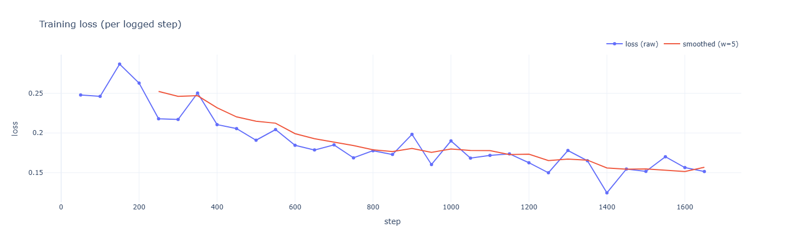

# PEFT Fine-tuning Recipes for Classification

A collection of Parameter Efficient Fine-Tuning (PEFT) recipes for text classification tasks using LoRA (Low-Rank Adaptation) and Llama models. This repository demonstrates how to fine-tune large language models efficiently for classification tasks using quantization and LoRA adapters.

## Features

- **Efficient Fine-tuning**: Uses LoRA (Low-Rank Adaptation) for parameter-efficient fine-tuning
- **8-bit Quantization**: Leverages BitsAndBytesConfig for memory-efficient training
- **Interactive Visualization**: Plotly-based training loss and evaluation metrics visualization
- **Multiple Interfaces**: Both Python scripts and Jupyter notebook workflows
- **Automated Setup**: UV-based dependency management and automation scripts

## Quick Start

### Prerequisites

- Python 3.9 or higher
- NVIDIA GPU with CUDA support (recommended)
- [UV package manager](https://github.com/astral-sh/uv) for dependency management

### Installation

1. **Clone the repository:**
   ```bash
   git clone https://github.com/jasonjiang8866/peft-fine-tuning-recipes-classification.git
   cd peft-fine-tuning-recipes-classification
   ```

2. **Install UV (if not already installed):**
   ```bash
   pip install uv
   ```

3. **Set up the environment:**
   ```bash
   uv run setup
   ```

   Or for training-only setup (no Jupyter dependencies):
   ```bash
   uv run setup-training
   ```

### Usage

#### Option 1: Using the Setup Script (Recommended)

**Full setup with Jupyter support:**
```bash
python setup.py setup
```

**Training-only setup (no Jupyter dependencies):**
```bash
python setup.py setup-train
```

**Setup with HuggingFace authentication:**
```bash
python setup.py setup-hf
```

**Run training:**
```bash
python setup.py train
```

**Start Jupyter Notebook:**
```bash
python setup.py notebook
```

**Start Jupyter Lab:**
```bash
python setup.py lab
```

**Generate visualizations:**
```bash
python setup.py visualize
```

**Clean up generated files:**
```bash
python setup.py clean
```

#### Option 2: Using UV Directly

**Install dependencies:**
```bash
uv pip install -e .        # Training only
uv pip install -e .[dev]   # With Jupyter support
```

**Run training:**
```bash
uv run python training.py
```

#### Option 2: Manual Setup

1. **Install dependencies:**
   ```bash
   pip install -e .
   ```

2. **Set up HuggingFace authentication:**
   ```bash
   python jupyter_setup.py
   ```

3. **Run training:**
   ```bash
   python training.py
   ```

4. **Or use the Jupyter notebook:**
   ```bash
   jupyter notebook finetuning.ipynb
   ```

## Optional Muon benchmark

`python training.py` and `python setup.py train` still use Hugging Face Trainer's
default AdamW optimizer. To compare that path with built-in `torch.optim.Muon`,
run the separate benchmark on a CUDA GPU with access to the gated Llama model:

```bash
python benchmark_muon.py --output-dir benchmark_runs
# Short functional run, using the same limits in both independent processes:
python benchmark_muon.py --output-dir benchmark_smoke --max-steps 20 --batch-size 8
```

Each process builds a fresh model and uses seed 42 before initializing the
classification head. The benchmark retains AG News, 8-bit base weights, the
LoRA configuration, warmup, and the one-epoch training recipe. Both arms use
the same batch size and number of steps. The AdamW arm leaves Trainer's
optimizer selection intact. The Muon arm updates only LoRA matrices with
`torch.optim.Muon` (default benchmark LR 0.02); the trainable `score` head is
updated with `torch.optim.AdamW` (recipe LR 2e-4). These are exploratory
learning rates, not a tuned optimizer-quality comparison. Use `--muon-lr` to
try other values. Benchmark runs log loss every step and disable checkpoints;
they evaluate the final model on the same AG News test split.

The recipe's `r=16`, `bias="none"`, and four attention projection targets imply
two matrix adapters per projection per layer. For the model's 16 layers,
2048 hidden units, and 512 key/value projection outputs, the expected shapes
are:

| Trainable target | LoRA A per layer | LoRA B per layer | Matrix count |
| --- | --- | --- | ---: |
| `q_proj`, `o_proj` | `[16, 2048]` | `[2048, 16]` | 64 |
| `k_proj`, `v_proj` | `[16, 2048]` | `[512, 16]` | 64 |
| Saved `score` head | — | `[4, 2048]` | 1 |

That is **128 trainable 2D LoRA matrices plus one 2D classifier weight**,
approximately 3,416,064 trainable elements in total. The head has no bias.
The runner
inspects `model.named_parameters()` *after* PEFT wraps the model; it records
every actual trainable name, shape, and dimension in `adamw.json` and
`muon.json`, and rejects any non-2D LoRA tensor before constructing Muon.
Additional trainable tensors, if introduced by a library/config change, go
to AdamW in the Muon arm. The base model stays frozen.

`comparison.json` summarizes final test accuracy/F1, mean training step time
(CUDA synchronized, excluding the first five optimizer steps by default),
and peak allocated/reserved CUDA MiB per device. Each arm's JSON also contains
per-step loss and step times, total training loss, exact parameter audit, and
library versions. Peak CUDA memory is measured from before model loading
through test evaluation. Step timing excludes data preparation, initial model
loading, validation and test evaluation. A short `--max-steps` run checks the
code path but its final accuracy is not a convergence result.

The project-wide minimum is Python >=3.9 and torch >=2.0. Environments differ:

| Environment | What runs | Upgrade for the Muon arm |
| --- | --- | --- |
| Checked-in `uv.lock`: torch 2.8.0 | AdamW; Muon recorded as skipped | Install PyTorch >=2.9 with matching CUDA wheel/driver in an isolated environment |
| Python 3.9 | Existing recipe (if its dependencies resolve) | Also move to Python >=3.10 for PyTorch >=2.9 |
| PyTorch build exposing `torch.optim.Muon` | Both benchmark arms | None; the runner detects the feature directly |
| `tonyf/muonium` experiment | Outside this benchmark | Python >=3.12 and PyTorch >=2.12.1 |

PyTorch 2.9 introduced the [built-in optimizer](https://docs.pytorch.org/docs/stable/generated/torch.optim.Muon.html).
[`tonyf/muonium`](https://github.com/tonyf/muonium) is a separate DTensor-based
implementation and is not installed by this patch. The project's minimum
dependency and lockfile are unchanged.

### Regression tests and CI

Run the lightweight suite from the repository root; it uses only `unittest`
and the Python standard library. `-S` disables site packages, so this command
requires no torch, Transformers, GPU, credentials, or model/dataset downloads:

```bash
python -S -m unittest discover -s tests -v
```

The tests use synthetic parameter names/shapes (including the expected 128
LoRA matrices), exclude frozen tensors, reject non-2D LoRA, route the score
head and other trainable tensors to AdamW, and check feature detection and
optimizer delegation. They execute `training.py` with inert dependency doubles
to check that an unset/empty benchmark switch imports no benchmark code,
passes no optimizer/callback overrides, and preserves the default arguments.
This verifies entry-point wiring, not a real Trainer training run.

CI runs that suite on Python 3.9–3.14 without installing project dependencies.
A separate Python 3.12 job installs only `torch==2.9.0` from the CPU wheel index
and runs `tests/test_optimizer_pair_cpu.py`. Locally, in an environment with
native Muon, run it with:

```bash
python -m unittest discover -s tests -p test_optimizer_pair_cpu.py -v
```

That CPU test performs real Muon and AdamW updates on tiny synthetic tensors,
checks distinct learning rates under `LambdaLR` linear warmup/decay (the
mechanism used by Trainer's default linear schedule), and checks optimizer +
scheduler state restoration against uninterrupted execution. It is explicitly
skipped when torch or native Muon is absent, including in the stdlib CI job.

`OptimizerPair.param_groups` shares the children's dictionaries so scheduler
updates reach both optimizers; `load_state_dict` must reconnect those references
after child optimizers replace their groups. The pair's outer `.state` does
not represent the child states; its `state_dict()` uses nested `muon`/`adamw`
entries. CPU coverage does not establish compatibility with every
Trainer/Accelerate version, mixed precision, checkpoint orchestration, or
integrations that inspect optimizer internals. Benchmark checkpoints remain
disabled, and distributed execution is outside this runner's scope.

The actual 8-bit/bf16 PEFT recipe still needs the CUDA smoke run above to
validate Trainer/Accelerate wrapping, quantized model gradients, device
placement, and callbacks. CUDA timing/memory measurements and any performance
or convergence comparison require real GPU runs; passing CI supplies none of
those results. No default dependency requirement or lockfile is changed.

## Training Results Visualization

The training process generates interactive HTML visualizations of the training progress:

### Training Loss Visualization



The training process automatically generates `train_loss.html` with an interactive Plotly chart showing:
- Training loss per step
- Smoothed loss curves for trend analysis
- Hover tooltips with detailed metrics

### Evaluation Metrics

The system also generates `eval_metrics.html` with comprehensive evaluation metrics including:
- Accuracy progression
- F1 score evolution
- Precision and recall metrics
- Runtime statistics

## Project Structure

```
├── pyproject.toml          # UV project configuration with dependencies
├── setup.py               # Automated setup script for all tasks
├── README.md              # This file
├── LICENSE                # MIT License
├── training.py            # Main training script
├── viz.py                 # Visualization utilities
├── jupyter_setup.py       # Environment setup for Jupyter
├── finetuning.ipynb      # Interactive Jupyter notebook
├── train_loss.html       # Generated training loss visualization
└── eval_metrics.html     # Generated evaluation metrics visualization
```

## Model Configuration

The default configuration uses:
- **Base Model**: `meta-llama/Llama-3.2-1B-Instruct`
- **Dataset**: AG News (4-class news categorization)
- **Quantization**: 8-bit with BitsAndBytesConfig
- **LoRA Configuration**:
  - Rank (r): 16
  - Alpha: 32
  - Dropout: 0.1
  - Target modules: All linear layers

## Customization

### Changing the Model

Edit `training.py` and modify the `MODEL` variable:
```python
MODEL = "meta-llama/Llama-3.2-1B-Instruct"  # Change to your preferred model
```

### Adjusting LoRA Parameters

Modify the LoRA configuration in `training.py`:
```python
lora = LoraConfig(
    r=16,                    # Increase for more parameters
    lora_alpha=32,           # Scaling factor
    lora_dropout=0.1,        # Dropout rate
    bias="none",
    task_type="SEQ_CLS",
    target_modules="all-linear"  # Target specific modules
)
```

### Using Different Datasets

Replace the dataset loading in `training.py`:
```python
ds = load_dataset("your_dataset_name")
```

## Hardware Requirements

**Minimum:**
- 8GB GPU memory (with 8-bit quantization)
- 16GB system RAM

**Recommended:**
- 16GB+ GPU memory
- 32GB+ system RAM
- NVIDIA RTX 3080/4080 or better

## Troubleshooting

### Common Issues

1. **CUDA Out of Memory**: Reduce batch size or enable gradient checkpointing
2. **HuggingFace Authentication**: Run `uv run setup-hf` to configure authentication
3. **Package Conflicts**: Use `uv run clean` to reset the environment

### Environment Variables

Set these environment variables for better control:
```bash
export HUGGINGFACE_HUB_TOKEN="your_token_here"  # For private models
export WANDB_DISABLED="true"                    # Disable Weights & Biases logging
export HF_HOME="/path/to/cache"                 # Custom HuggingFace cache directory
```

## Contributing

1. Fork the repository
2. Create a feature branch
3. Make your changes
4. Add tests if applicable
5. Submit a pull request

## License

This project is licensed under the MIT License - see the [LICENSE](LICENSE) file for details.

## Citation

If you use this code in your research, please consider citing:

```bibtex
@software{peft_classification_recipes,
  title={PEFT Fine-tuning Recipes for Classification},
  author={JYC},
  year={2025},
  url={https://github.com/jasonjiang8866/peft-fine-tuning-recipes-classification}
}
```

## Acknowledgments

- [Hugging Face](https://huggingface.co/) for the transformers and PEFT libraries
- [Microsoft](https://github.com/microsoft/LoRA) for the LoRA technique
- [Meta](https://ai.meta.com/llama/) for the Llama model series
- [Plotly](https://plotly.com/) for visualization capabilities
